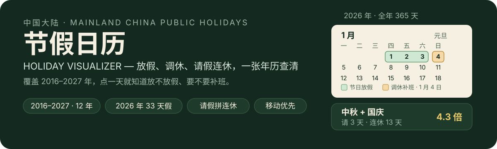
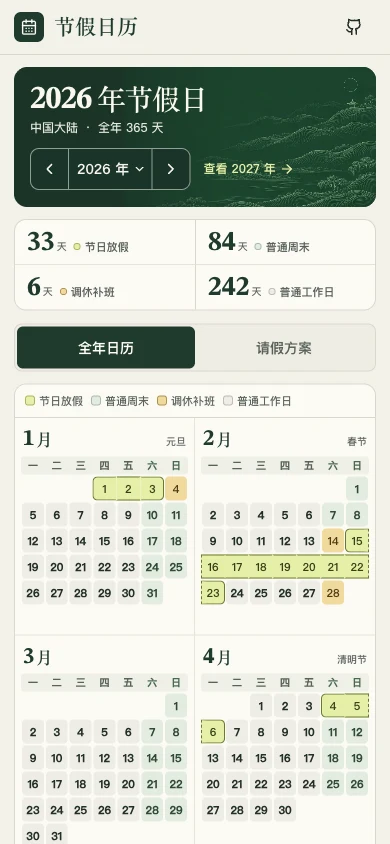
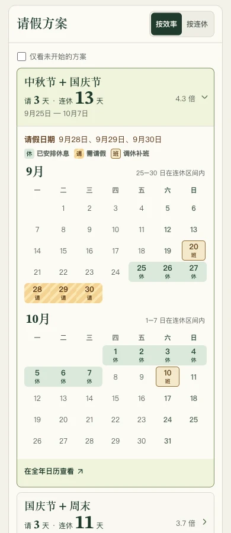

<p align="right"><a href="README.md">中文</a></p>

<p align="center">
  
</p>

<p align="center">
  <a href="https://holiday-visualizer.xiaosang.cc/">▶ View Online</a>
  ·
  <a href="https://github.com/holynova/holiday-visualizer">GitHub Repository</a>
</p>

Holiday Visualizer is a calendar for mainland China's public holidays, make-up workdays, and leave planning, covering 2016–2027. Pick a year, tap any day to see whether it's a holiday, a weekend, or a make-up workday; leave plans ranked by efficiency show how a few days off stretch into a long break — e.g. in 2026, Mid-Autumn + National Day: 3 days off becomes 13 days out.

## Screenshots

<p align="center">
  <a href="https://holiday-visualizer.xiaosang.cc/"></a>
  <a href="https://holiday-visualizer.xiaosang.cc/"></a>
</p>

<p align="center">
  <a href="https://holiday-visualizer.xiaosang.cc/"></a>
</p>

## How to Use

- **Check any day**: pick a year and tap a date. Consecutive holidays share a border; cross-week or cross-month spans use dashed connectors. Four day types at a glance: public holiday, regular weekend, make-up workday, regular workday.
- **Build a long break**: leave plans are ranked by efficiency or total break length. Expand a plan and the month view marks days with 「休」 ("Rest"), 「请」 ("Leave"), and 「班」 ("Work"); a make-up day that also needs leave shows both markers.
- **Share a year**: after switching years, copy the current URL — e.g. [the 2027 calendar](https://holiday-visualizer.xiaosang.cc/?year=2027).

Leave plans are calculated within a single calendar year, bridging adjacent rest periods with 1–5 workdays off. Efficiency = rest days ÷ leave days.

## Data

Each year's holiday schedule lives in its own JSON file (`src/utils/holidayData/2016.json` … `2027.json`), based on the State Council's official holiday notices. Official notice links for 2026 and 2027 are in the old README and in `yearSources` in the code:

- 2026: [Beijing Municipal Government · 2026 holiday schedule](https://www.beijing.gov.cn/zhengce/zhengcefagui/202511/t20251104_4258873.html)
- 2027: [China Employment Web · 2027 holiday schedule](https://chinajob.mohrss.gov.cn/h5/c/2026-11-09/635850.shtml)

For 2026: 33 holiday days (including 9 for Spring Festival), 6 make-up workdays, 84 regular weekends, 242 regular workdays.

## Run Locally

```bash
pnpm install --frozen-lockfile
pnpm dev
```

## Tech

- React 17 + TypeScript + Vite 2, antd 5 for UI, framer-motion for animation, date-fns for date math.
- Holiday data is static JSON; all computation is client-side, no backend. The year is shared via the `?year=` URL parameter.
- Mobile-first: the full-year calendar and leave plans are both mobile layouts.

```
src/pages/HolidayPage/   Main page: yearly calendar, leave plans, month views
src/utils/holidays.ts    Date classification, leave-plan computation (1–5 day bridges, efficiency ratio)
src/utils/holidayData/   2016–2027 holiday schedule JSON (one file per year)
```
