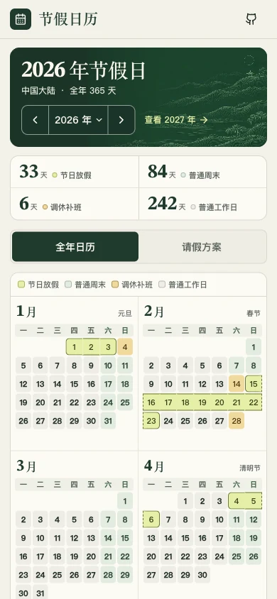
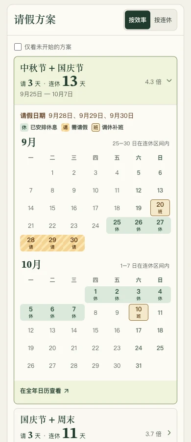

# 节假日历

一张年历查清中国大陆的节日放假、调休补班和请假连休。覆盖 **2016–2027 年**。

[在线体验 / Live Demo](https://holiday-visualizer.xiaosang.cc/) · [GitHub Repo](https://github.com/holynova/holiday-visualizer)

<p>
  <a href="https://holiday-visualizer.xiaosang.cc/"></a>
  <a href="https://holiday-visualizer.xiaosang.cc/"></a>
</p>

## 怎么用

- **查日期**　选年份，再点某一天。连续节日共用边框，跨周或跨月用虚线接续。
- **拼连休**　按请假效率或连休天数排序。展开方案后，月历用「休」「请」「班」区分日期。补班日如果也需要请假，会显示两个标记。
- **分享年份**　切换年份后可复制当前地址，例如 [2027 年日历](https://holiday-visualizer.xiaosang.cc/?year=2027)。

请假方案以单个公历年为计算范围，用 1–5 个工作日连接相邻休息时段。详见官方 [2026 年通知](https://www.beijing.gov.cn/zhengce/zhengcefagui/202511/t20251104_4258873.html) 和 [2027 年通知](https://chinajob.mohrss.gov.cn/h5/c/2026-11-09/635850.shtml)。

### 手机扫码

<a href="https://holiday-visualizer.xiaosang.cc/"></a>

## English

Browse mainland China's public holiday schedules from 2016 to 2027. The annual calendar groups consecutive holiday dates. Open a leave plan to see rest days, days to request off, and make-up workdays together in a month-by-month view.

## 本地运行 / Run locally

```bash
pnpm install --frozen-lockfile
pnpm dev
```

## 发布 / Deploy

```bash
pnpm build
pnpm deploy:check
pnpm deploy
```

从 `main` 分支手动发布到现有 Cloudflare Worker。生产构建输出位于 `dist/`。
